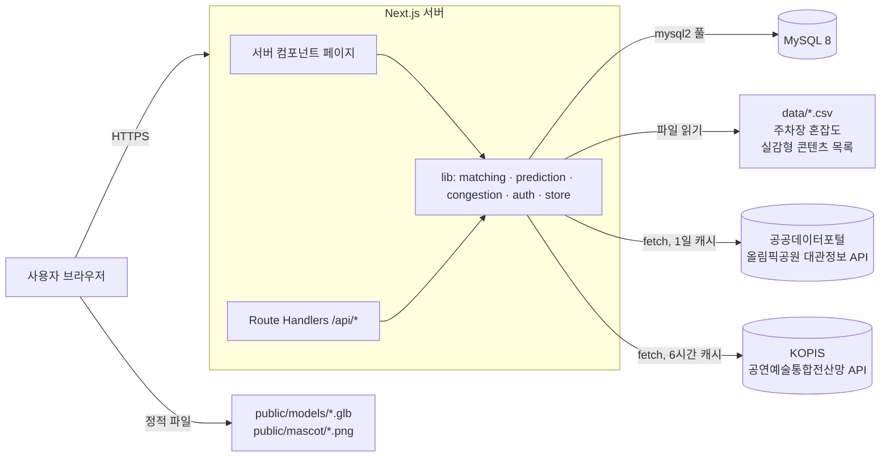
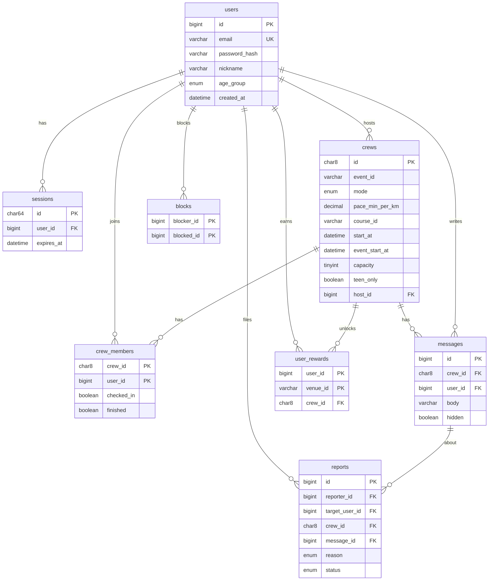
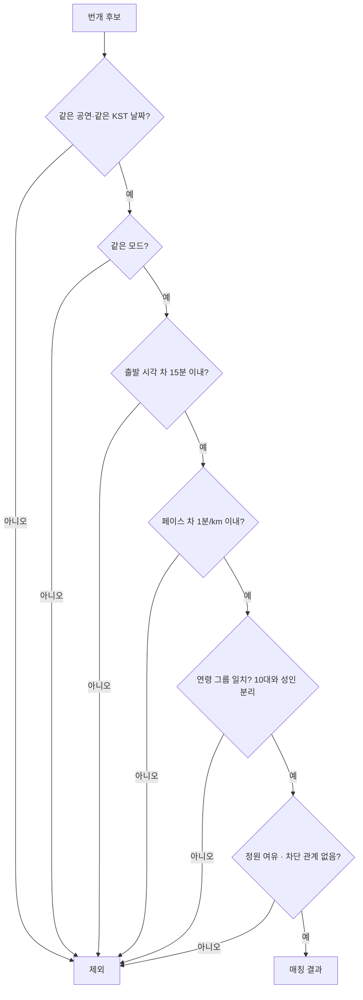
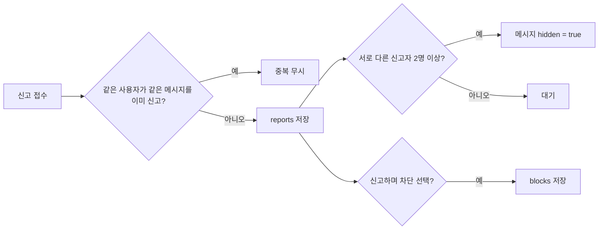
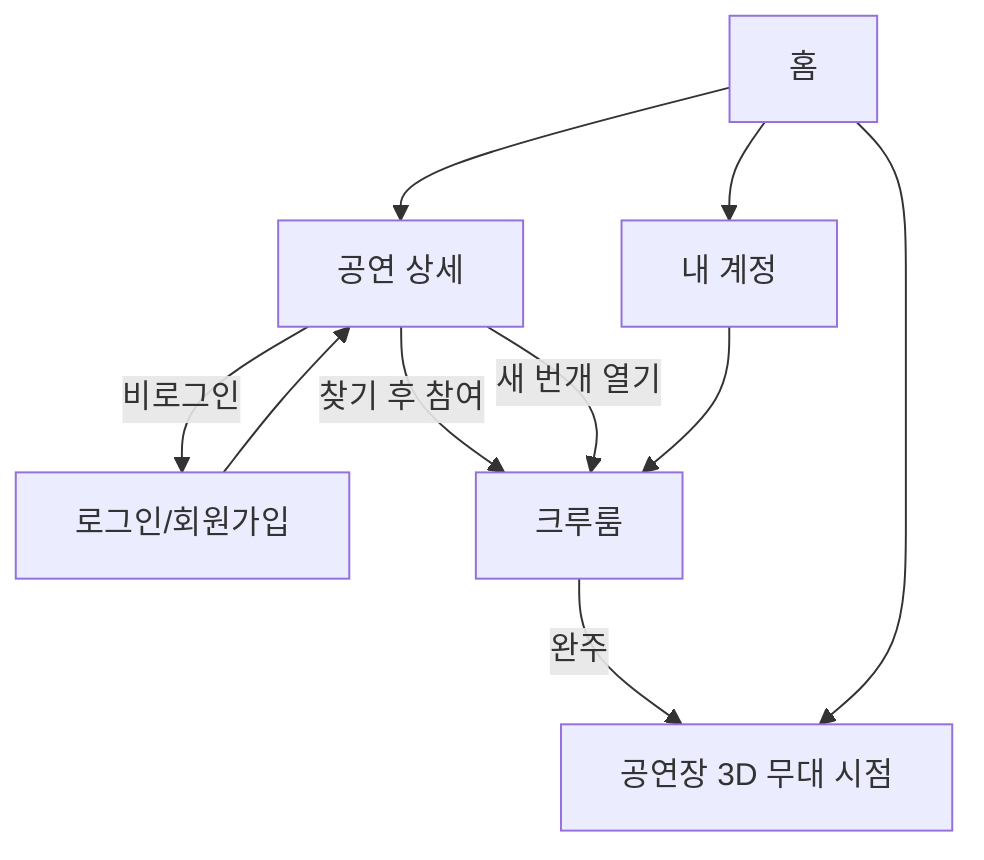

# 공연 전 한 바퀴 설계서

> 올림픽공원 공연×러닝 크루 매칭 서비스 · 한국체육산업개발(주) 개방 공공데이터 활용 공모전 출품작
> 본 문서는 구현된 코드(`src/`, `db/schema.sql`)를 기준으로 작성했습니다.

---

## 1. 개요

### 1.1 목적

콘서트·공연을 보러 온 관객에게는 입장 전 1~2시간의 **대기시간**이 생깁니다. 이 시간에 같은 공연을 보러 온 사람끼리 올림픽공원을 함께 걷거나 달리는 **번개 모임(크루)** 을 만들고, 공연장 주변 혼잡을 피해 공원 전체로 분산시키는 것이 목적입니다.

### 1.2 해결하려는 문제

| 문제 | 해결 방식 |
|---|---|
| 공연 전 대기시간이 지루하고 혼자 보내기 아쉽다 | 같은 공연 관객끼리 산책·조깅·러닝 번개 매칭 |
| 공연장 주변이 특정 시간대에 몰려 혼잡하다 | 주차 혼잡 이력과 공연 규모로 "몇 시부터 붐비는지" 예측하고, 한산한 산책 시간을 추천 |
| 낯선 사람과 만나는 것이 불안하다 | 회원제, 10대 분리 매칭, 채팅 신고·차단, 공개 장소 집결 |
| 공연장 내부를 미리 알고 싶다 | 공연장 3D 둘러보기, 크루 완주 시 '무대 시점' 보상 |

### 1.3 용어

| 용어 | 뜻 |
|---|---|
| 번개 / 크루 | 같은 공연, 같은 날짜, 같은 모드로 모인 소규모 모임(2~8명) |
| 모드 | 산책(walk) · 가벼운 조깅(jog) · 러닝(run) |
| 혼잡 이력 지수 | 주차장 혼잡도 CSV에서 요일유형·시간대별로 계산한 0~1 값 |
| 공연부하 | 공연 규모와 관객 도착 패턴으로 만든 추가 혼잡분 |
| 무대 시점 | 완주 보상으로 열리는 공연장 3D의 객석 시점 |

---

## 2. 요구사항

### 2.1 기능 요구사항

| ID | 요구사항 | 구현 위치 |
|---|---|---|
| F-01 | 공연 목록 조회·검색·공연장 필터 | `/`, `ShowSearch`, `api/shows` |
| F-02 | 현재 시간대 주차 혼잡 이력 표시 | `CongestionPanel`, `api/congestion` |
| F-03 | 공연일 혼잡 예측, 추천 산책 시간 | `PredictionCard`, `lib/prediction.ts` |
| F-04 | 회원가입·로그인·로그아웃 | `AuthForm`, `api/auth/*` |
| F-05 | 번개 찾기(매칭), 참여 | `CrewFinder`, `lib/matching.ts`, `api/crews` |
| F-06 | 번개 열기(코스 추천, 입장 시간 검증) | `CrewFinder`, `recommendCourses`, `validateTiming` |
| F-07 | 크루룸(카운트다운, 집결지 지도, 멤버) | `CrewRoom`, `CourseMap` |
| F-08 | 크루 채팅 | `CrewChat`, `api/crews/[id]/messages` |
| F-09 | 신고·차단 | `ReportDialog`, `api/reports`, `api/blocks` |
| F-10 | 위치 체크인, 완주 처리 | `CrewRoom`, `PATCH api/crews/[id]` |
| F-11 | 공연장 3D 뷰어, 단면 보기 | `VenueViewer` |
| F-12 | 완주 보상(무대 시점 해금) 저장 | `user_rewards`, `unlockedVenues` |
| F-13 | 내 계정(내 번개, 해금 목록, 차단 관리) | `/account`, `BlockList` |
| F-14 | 크루 일정 캘린더 추가(.ics, Google 캘린더, 출발 30분 전 알림), 집결지 카카오맵 길찾기 | `CrewRoom`, `lib/calendar.ts`, `api/crews/[id]/calendar` |

### 2.2 비기능 요구사항

| 구분 | 기준 |
|---|---|
| 보안 | 비밀번호 단방향 해시(scrypt), 세션 토큰은 해시만 저장, httpOnly 쿠키, 로그인 시도 제한 |
| 개인정보 | 실명·전화번호를 받지 않음. 이메일, 닉네임(1~12자), 연령대만 수집 |
| 안전 | 만 14세 미만 가입 불가, 10대는 10대끼리만 매칭, 신고 누적 시 메시지 자동 가림 |
| 시간 | 모든 DB 시각은 UTC로 저장, 화면은 KST로 표시 |
| 성능 | 대관정보 API 응답을 1일 캐시, KOPIS 공연 일정은 6시간 캐시(상세 24시간), 3D 모델은 meshopt 압축(최대 26MB) |
| 접근성 | 키보드 포커스 링, 입력칸 경계 대비 3:1 이상, 장식 이미지 숨김, `prefers-reduced-motion` 대응 |
| 반응형 | 모바일 우선, 데스크톱에서는 2단 배치 |

---

## 3. 시스템 아키텍처

### 3.1 구성도



### 3.2 계층

| 계층 | 역할 | 위치 |
|---|---|---|
| 화면 | 페이지(서버 컴포넌트)와 상호작용 컴포넌트(클라이언트) | `src/app`, `src/components` |
| API | 요청 검증, 인증 확인, 응답 | `src/app/api/**/route.ts`, `lib/api.ts`, `lib/validate.ts` |
| 도메인 | 매칭·예측·혼잡 계산(순수 함수) | `lib/matching.ts`, `lib/prediction.ts`, `lib/congestion.ts` |
| 저장소 | MySQL 접근, 트랜잭션 | `lib/db.ts`, `lib/store.ts`, `lib/auth.ts` |
| 데이터 로더 | API·CSV 읽기와 정규화 | `lib/data/*` |

순수 함수로 분리한 도메인 로직은 DB 없이 단위 테스트할 수 있습니다.

### 3.3 기술 스택

Next.js 15(App Router) · React 19 · TypeScript · Tailwind CSS 4 · MySQL 8(mysql2) · Three.js · fast-xml-parser · Vitest. 폰트는 SUIT Variable입니다.

### 3.4 시간대 처리

- 서버 풀 연결마다 `SET time_zone = '+00:00'`을 실행하고 mysql2는 `timezone: "Z"`로 설정합니다.
- 코드는 UTC `Date`로 다루고, 표시와 "같은 날짜" 판정은 KST(UTC+9)로 변환합니다.
- 공연 날짜 비교는 `kstDateString()` 기준입니다.

---

## 4. 공공데이터 활용 설계

| 데이터 | 형태 | 용도 | 연계 지점 |
|---|---|---|---|
| 올림픽공원 대관정보 | OpenAPI(XML), 성공코드 `0000` | 공연 목록(제목·장소), 공연장 판별 | `lib/data/shows.ts` |
| 주차장 혼잡도 정보 | CSV (2025-02-12 ~ 2026-08-12, 699건) | 요일·시간대별 혼잡 이력 지수, 공연일 혼잡 예측의 기저 | `lib/data/congestion.ts`, `lib/congestion.ts` |
| 올림픽공원 공연장 실감형 콘텐츠 | CSV + 3D 파일(SKP/DAE/GLB) | 5개 공연장 3D 뷰어 | `lib/data/venue3d.ts`, `public/models/` |
| (연계) KOPIS 공연예술통합전산망 | OpenAPI(XML), 오류는 `returncode` | 앞으로 90일 올림픽공원 공연의 기간·공연장·회차 | `lib/data/kopis.ts`(해석), `lib/data/kopisFetch.ts`(호출·캐시) |

### 4.1 대관정보 처리

1. `api.kcisa.kr` 응답에서 `title`, `spatial`만 사용합니다. 응답은 `revalidate: 86400`으로 하루 캐시합니다.
2. 제목+장소 해시(FNV-1a)로 공연 ID를 만들고, 중복을 제거한 뒤 최신순으로 뒤집어 711건의 목록을 만듭니다.
3. `spatial` 문자열을 `resolveVenue()`가 공연장으로 분류합니다. (체조→KSPO DOME, 핸드볼, 우리금융|K아트홀, 올림픽홀|뮤즈라이브, 수변, 잔디, 그 외 `other`)
4. API 실패 시 내장 기본 목록으로 대체하고 화면에 표시합니다.
5. 대관정보에는 공연 날짜·시각이 없어 사용자가 티켓 날짜·시각을 입력하고, **같은 공연 + 같은 날짜** 입력자끼리 매칭됩니다.

### 4.1.1 KOPIS 공연 일정 처리

1. 공연 목록(`pblprfr`)을 시설 코드 `FC001247`(올림픽공원)로 거릅니다. 개발가이드 v5.0의 제한(조회 기간 최대 31일, 한 번에 최대 100건)에 맞춰 앞으로 90일을 31일 구간 3개로 나눠 부르고, 100건이 차면 다음 페이지를 부릅니다.
2. 공연마다 상세(`pblprfr/{id}`)를 받아 기간(`prfpdfrom`~`prfpdto`), 공연장 코드(`mt13id`), 공연 시간(`prfruntime`), 공연 시각(`dtguidance`)을 씁니다. 시설 코드가 `FC001247`이 아니면 버립니다.
3. 공연장은 공연장 코드 끝 번호로 정합니다: 01 KSPO DOME, 02 핸드볼경기장, 03·04 올림픽홀(04는 안쪽 뮤즈라이브), 05 우리금융아트홀, 07 88잔디마당, 08 수변무대, 그 외 `other`.
4. `dtguidance`(예: `금요일(19:00), 토요일 ~ 일요일(16:00), HOL(14:00)`)를 요일별 시각으로 해석합니다(`parseDtGuidance`). 요일 범위는 일요일을 넘어갈 수 있고 하루 여러 회차를 지원합니다. 모르는 형식이 하나라도 있으면 해석하지 않고 직접 입력으로 바꿉니다.
5. 공연 기간 안에서 지금 이후·앞으로 90일 안의 날짜로 펼쳐 회차 목록을 만듭니다(`expandSessions`, 최대 150개). 공휴일 회차(`HOL`)는 어느 날이 공휴일인지 응답에 없어 넣지 않고 화면에 안내만 합니다.
6. 공연 ID는 `k-` + KOPIS ID(`k-PF301499`)로, 대관정보 ID와 겹치지 않습니다. 외부 주소에 들어가므로 `^PF\d+$` 형식만 받습니다.
7. 화면에서는 회차를 고르면 공연 시각이 정해지고, "티켓의 날짜·시각과 같은지 확인" 안내와 '직접 입력'을 함께 둡니다. 매칭 규칙(같은 공연 + 같은 날짜)은 대관정보 공연과 같습니다.
8. 호출: 인증키는 서버 환경변수 `KOPIS_SERVICE_KEY`로만 쓰고, 가이드의 평문 HTTP 대신 HTTPS(`https://kopis.or.kr`)로 부릅니다. KOPIS 이용제한(IP당 1초 10회 이상 호출 시 서비스 중지)에 맞춰 요청 시작 간격을 0.2초(초당 최대 5회)로 둡니다. 동시에 4개씩 불렀을 때 `400 Request Blocked`가 오고 약 5분 뒤 풀리는 것을 확인했습니다. 목록+상세를 합친 결과는 6시간, 공연 상세는 공연별로 24시간 캐시하고(`unstable_cache`), 일부라도 실패한 결과는 캐시하지 않습니다.
9. 출처: 이용 조건상 출처가 없으면 서비스가 중단될 수 있어, KOPIS 예시 형식(`출처 : (재)예술경영지원센터 공연예술통합전산망, www.kopis.or.kr`)을 모든 화면 하단과 공연 일정 옆에 표시합니다(`components/KopisCredit.tsx`).
10. 키가 없거나 호출이 실패하면 KOPIS 공연 없이 기존처럼 동작합니다(실패 후 5분간 재호출 안 함). 이미 열린 KOPIS 공연 번개의 크루방은 공연 정보를 못 찾아도 안내 문구로 열립니다.

### 4.2 주차장 혼잡도 처리

- CSV를 UTF-8로 변환해 `data/`에 두고 서버에서 읽습니다.
- 시각별 상태(원활/혼잡/만차)를 요일유형(주말·평일) × 시간(8~22시)으로 집계합니다.
- 지수 = 가중 평균(원활 0, 혼잡 0.6, 만차 1)을 관측 일수로 나눈 뒤 ±1시간 구간을 평활하고 정규화한 값입니다.
- 단계 기준: 0.25 미만 여유, 0.5 미만 보통, 0.75 미만 혼잡, 그 이상 매우혼잡.
- 주차구역(P1A~P11)별 요약도 함께 계산합니다.

### 4.3 실감형 콘텐츠 처리

- 5개 공연장 GLB를 meshopt로 압축해 `public/models/`에 둡니다.
- KSPO DOME은 SketchUp DAE(453MB)만 제공되어 직접 만든 스트리밍 변환기(`scripts/sketchup-dae-to-glb.mjs`)로 GLB 변환 후 압축했습니다(26MB).
- 원본 다운로드 링크는 CSV의 파일명과 기준 경로(`SOURCE_DOWNLOAD_BASE`)로 구성합니다.

---

## 5. 데이터베이스 설계

### 5.1 ERD



### 5.2 테이블 설명

| 테이블 | 설명 | 주요 제약 |
|---|---|---|
| `users` | 회원 | 이메일 유니크, 연령대 `14-19`·`20s`·`30s`·`40+` |
| `sessions` | 로그인 세션 | 기본키가 토큰의 SHA-256, 만료 30일, 사용자 삭제 시 CASCADE |
| `crews` | 번개 | 모드 `walk`·`jog`·`run`, 정원 2~8, `teen_only` 플래그, 인덱스 `(event_id, event_start_at)` |
| `crew_members` | 번개 참여자 | 복합 기본키 `(crew_id, user_id)`, 체크인·완주 플래그 |
| `messages` | 채팅 | 본문 500자 이하, `hidden`이 참이면 목록에서 제외, 인덱스 `(crew_id, id)` |
| `reports` | 신고 | 사유 `spam`·`abuse`·`harassment`·`unsafe`·`other`, 상태 `open`·`reviewed`·`dismissed` |
| `blocks` | 차단 관계 | 복합 기본키 `(blocker_id, blocked_id)` |
| `user_rewards` | 완주 보상 | 복합 기본키 `(user_id, venue_id)`로 공연장당 1회 |
| `rate_limits` | 요청 횟수 기록 | 복합 기본키 `(bucket, subject, window_start)`, `subject`는 이메일·IP의 SHA-256 해시, 하루 지난 행은 요청 중 가끔 삭제 |

공통: InnoDB, `utf8mb4`, 시각은 `DATETIME(3)`, 외래키는 대부분 `ON DELETE CASCADE`(신고의 크루·메시지 참조와 보상의 크루 참조는 `SET NULL`).

### 5.3 동시성

- 참여(`joinCrew`)는 트랜잭션 안에서 `SELECT … FOR UPDATE`로 크루 행을 잠가 정원 초과를 막습니다.
- 방장이 나가면 방장을 다른 멤버에게 넘기고, 마지막 멤버가 나가면 크루를 삭제합니다.
- 마이그레이션(`npm run db:migrate`)은 `CREATE TABLE IF NOT EXISTS`라 반복 실행해도 안전합니다.

---

## 6. API 설계

모든 응답은 JSON이며 오류는 `{ error }`와 HTTP 상태 코드로 반환합니다. 인증이 필요한 API는 `requireUser()`로 확인합니다.

| 메서드 | 경로 | 인증 | 설명 |
|---|---|---|---|
| POST | `/api/auth/signup` | – | 회원가입, 세션 쿠키 발급 (201) |
| POST | `/api/auth/login` | – | 로그인, 시도 제한 적용 |
| POST | `/api/auth/logout` | – | 세션 삭제 |
| GET | `/api/auth/me` | – | 현재 사용자와 해금한 공연장 (비로그인은 `user: null`) |
| GET | `/api/shows` | – | 공연 목록 |
| GET | `/api/congestion` | – | 현재 시간대 혼잡 이력, 곡선, 구역별 요약 |
| GET | `/api/prediction` | – | 공연일 혼잡 예측 (`eventId`, `eventStartAt`) |
| GET | `/api/crews` | 필요 | 조건에 맞는 번개 매칭. 내 크루와 차단 관계는 제외 |
| POST | `/api/crews` | 필요 | 번개 열기. 입장 시간·연령 검증 |
| GET | `/api/crews/[id]` | – | 크루 보기. 멤버 상세는 멤버에게만 |
| POST | `/api/crews/[id]` | 필요 | 참여 |
| PATCH | `/api/crews/[id]` | 필요 | 체크인·완주 처리, 완주 시 보상 기록 |
| DELETE | `/api/crews/[id]` | 필요 | 나가기 |
| GET | `/api/crews/[id]/calendar` | 멤버 | 크루 일정 `.ics` (`text/calendar`, 30분 전 알림 포함, 닉네임 미포함) |
| GET | `/api/crews/[id]/messages` | 멤버 | 채팅 조회 (`after` 이후 증분) |
| POST | `/api/crews/[id]/messages` | 멤버 | 메시지 전송 |
| POST | `/api/reports` | 멤버 | 신고 |
| GET | `/api/blocks` | 필요 | 내 차단 목록 |
| POST | `/api/blocks` | 필요 | 차단 |
| DELETE | `/api/blocks/[userId]` | 필요 | 차단 해제 |

### 6.1 입력 검증

`lib/validate.ts`가 모드·페이스(3~20분/km)·날짜·프로필(닉네임·연령대)을 검증합니다. 비밀번호는 8~72자에 영문과 숫자를 포함해야 합니다. 로그인 후 이동 경로(`next`)는 같은 사이트의 내부 경로만 허용해 오픈 리다이렉트를 막습니다.

---

## 7. 핵심 로직 설계

### 7.1 매칭 (`lib/matching.ts`)



| 항목 | 값 |
|---|---|
| 출발 시각 허용 오차 | ±15분 (`MATCH_WINDOW_MIN`) |
| 페이스 허용 오차 | ±1.0분/km (`PACE_TOLERANCE`) |
| 가장 이른 출발 | 공연 시작 150분 전 (`EARLIEST_BEFORE_MIN`) |
| 입장 여유 | 입장 30분 전까지 도착 (`ENTRY_BUFFER_MIN`) |
| 정원 | 2~8명 |
| 기본 페이스 | 산책 12, 조깅 7.5, 러닝 5.5 (분/km) |

**입장 시간 검증(`validateTiming`)**: 코스 거리 ÷ 페이스로 소요 시간을 구하고, 공연장까지 도보 시간과 입장 여유를 더해 **가장 늦은 출발 시각**을 계산합니다. 선택한 출발 시각이 가장 이른 시각과 가장 늦은 시각 사이가 아니면 번개를 열 수 없고, 가능한 구간을 안내합니다.

**코스 추천(`recommendCourses`)**: 모드와 공연장, 예측 혼잡 단계를 입력으로 코스를 점수화합니다. 출발 시각이 혼잡(혼잡·매우혼잡)으로 예측되면 공연장 반경 0.8km(`CROWD_RADIUS_KM`) 안의 코스는 "공연장 인파"로 표시하고 순위를 낮춰, 공연장에서 떨어진 집결지를 우선 추천합니다. 코스는 몽촌호 한 바퀴(1.7km), 세계평화의 문 · 88잔디마당 산책(2.6km), 몽촌토성 한 바퀴(2.8km), 올림픽공원 외곽 순환(5.5km) 4개입니다. 경로는 OpenStreetMap의 공원 안 보행로를 따라 집결지와 경유 지점을 최단 경로로 잇고 막다른 갈래를 잘라냈으며, 공연장 좌표도 OpenStreetMap 기준입니다(`lib/parkGeo.ts`).

### 7.2 혼잡 이력 지수 (`lib/congestion.ts`)

```
지수(요일유형, 시) = Σ 가중치(상태) ÷ 관측 일수   (±1시간 평활 후 0~1 정규화)
가중치: 원활 0 · 혼잡 0.6 · 만차 1
단계:   0.25 미만 여유 / 0.5 미만 보통 / 0.75 미만 혼잡 / 그 이상 매우혼잡
```

### 7.3 공연일 혼잡 예측 (`lib/prediction.ts`)

```
예측지수(t) = min(1, 기저(t) × 0.6 + 규모계수 × max(본 도착(t), 조기 도착(t) × 0.45))
본 도착(t)   = 가우시안(t; 공연 시작 70분 전, σ 45분)
조기 도착(t) = 가우시안(t; 공연 시작 180분 전, σ 60분)
규모계수     = (공연장 수용 인원 ÷ 15,000) ^ 0.6        (KSPO DOME 만석 = 1)
```

- 30분 간격으로 계산하고, 기저는 혼잡 이력 지수를 선형 보간한 값입니다.
- **붐비기 시작하는 시각(`crowdFrom`)**: 공연부하가 0.3 이상이 되는 첫 시각입니다.
- **혼잡 시작(`busyFrom`)**: 공연 시작 전 처음으로 예측지수가 0.5 이상이 되는 시각입니다.
- **추천 산책 시간(`walkWindow`)**: 공연 150분 전~60분 전 사이에서 60분 평균 예측지수가 가장 낮은 구간입니다. 화면의 "추천 시간으로 맞추기" 버튼이 이 시각을 출발 시각에 넣습니다.
- 공연장별 수용 인원: KSPO DOME 15,000 · 88잔디마당 10,000 · 핸드볼 5,000 · 수변무대 3,000 · 올림픽홀 2,500 · 우리금융아트홀 1,200 · 기타 8,000.
- 공연일과 주차 기록을 직접 연결한 데이터가 없어 도착 분포와 규모계수는 **가정값**입니다. 입출차·공연·날씨 연계 데이터(15164822)로 보정할 수 있도록 상수를 한곳에 모았습니다.

### 7.4 채팅 (`CrewChat`, `messages` API)

| 항목 | 설계 |
|---|---|
| 전달 방식 | 3초 간격 폴링, `after=<마지막 id>`로 증분 조회 |
| 전송 제한 | 사용자당 1초에 1건·1분에 30건(`rate_limits`), 500자 이하 |
| 열람 권한 | 크루 멤버만 |
| 종료 | 공연 시작 3시간 후 채팅 닫힘 |
| 필터 | 자동 가림(`hidden`) 메시지, 차단 관계의 메시지는 서버에서 제외 |

### 7.5 신고·차단



- 차단하면 **양방향**으로 메시지가 보이지 않고, 서로의 번개 매칭·참여에서 제외됩니다.
- 신고 사유는 괴롭힘, 욕설·혐오, 안전 위협, 광고·도배, 기타입니다.

### 7.6 체크인·완주·보상

1. 위치 체크인은 브라우저 Geolocation으로 집결지 300m 이내인지 확인합니다. 위치를 쓸 수 없으면 수동 체크인을 제공합니다.
2. 화면은 체크인한 멤버에게만 "완주" 버튼을 보여 주고, 완주하면 `user_rewards`에 `(user_id, venue_id)`가 기록됩니다. 서버(`PATCH`)가 체크인 여부를 강제하지는 않으므로 향후 서버 검증을 추가할 계획입니다.
3. 해금된 공연장은 `/api/auth/me`로 내려가 3D 뷰어의 '무대 시점' 버튼을 엽니다.

---

## 8. 인증·보안 설계

| 항목 | 설계 |
|---|---|
| 비밀번호 | scrypt 해시, 저장 형식 `scrypt$N$r$p$salt$hash`, 비교는 `timingSafeEqual` |
| 세션 | 랜덤 토큰을 발급하고 DB에는 **SHA-256 해시만** 저장, 만료 30일 |
| 쿠키 | `orc_session`, httpOnly, sameSite=lax |
| 로그인 시도 | 실패를 IP당 20회/10분, 같은 IP의 같은 이메일 5회/10분, 이메일 전체 50회/시간으로 제한. 비밀번호 확인 전에 세고(동시 요청에도 정확), 성공하면 되돌림. 다른 IP의 진짜 사용자는 막지 않음 |
| 회원가입 | IP당 5회/시간. 입력 형식 검사 뒤, scrypt 계산 전에 셈 |
| 요청 제한 저장 | `rate_limits` 테이블(DB). 재시작·여러 서버 인스턴스에서도 유지. 한 문장(`INSERT … ON DUPLICATE KEY UPDATE`)으로 세어 동시 요청에 안전. 초과 시 429 + `Retry-After` |
| 접속 IP | `X-Forwarded-For` 첫 값. Vercel이 실제 IP로 덮어쓰는 것을 전제로 함 |
| 권한 | 크루 상세·채팅·신고는 멤버만, 멤버 상세 정보는 비멤버에게 비노출 |
| SQL | 모든 쿼리를 파라미터 바인딩으로 실행 |
| 비밀값 | API 키와 DB 주소는 `.env.local`(git 제외), 예시는 `.env.example` |
| DB 계정 | 앱은 전용 계정(`orc_app`)만 사용 |

### 8.1 개인정보 최소 수집

이메일, 닉네임, 연령대만 저장합니다. 위치는 체크인 순간의 거리 계산에만 쓰고 저장하지 않습니다.

---

## 9. 화면 설계

### 9.1 화면 목록

| 경로 | 화면 | 주요 구성 |
|---|---|---|
| `/` | 홈 | 히어로(마스코트), 주차 혼잡 이력, 모집 중인 번개, 공연 찾기 |
| `/events/[id]` | 공연 상세 | 티켓 정보, 혼잡 예측, 번개 조건, 매칭 결과, 새 번개 열기 |
| `/crews/[id]` | 크루룸 | 카운트다운, 집결지 지도, 멤버, 채팅, 체크인·완주 |
| `/venues` | 공연장 3D | 5개 공연장 뷰어, 단면 보기, 무대 시점, 원본 다운로드 |
| `/login`, `/signup` | 인증 | 폼과 마스코트 |
| `/account` | 내 계정 | 내 번개, 해금한 무대 시점, 차단 관리 |

### 9.2 화면 흐름



### 9.3 디자인 시스템

| 요소 | 기준 |
|---|---|
| 색 | 흰 바탕, 하늘색 그라데이션 히어로, 로열블루(주 동작), 네이비(글자·푸터) |
| 혼잡도 색 | 여유 하늘색 · 보통 노랑 · 혼잡 오렌지 · 매우혼잡 네이비 |
| 모양 | 카드 28px 라운드, 버튼·칩·태그 알약형, 번호 원형 목록 |
| 폰트 | SUIT Variable 한 가지 |
| 토큰 | 색·간격·반경·그림자를 `src/app/tokens.css`에 모으고 `ui.css`가 공용 클래스(`.btn`, `.cell`, `.chip`, `.tag` 등)를 정의 |
| 마스코트 | 시트를 포즈 7개의 투명 PNG로 잘라 화면마다 배치 (`Mascot` 컴포넌트) |

---

## 10. 3D 설계

- **로딩:** Three.js `GLTFLoader` + `MeshoptDecoder`, 진행률 표시.
- **프레이밍:** 메시 바운딩 박스의 1~99 퍼센타일로 초점 박스를 잡아 방위 표시 같은 이상치를 무시하고, 시야각에서 카메라 거리를 계산합니다.
- **단면 보기:** 클리핑 평면으로 지붕을 잘라 내부를 보여줍니다.
- **무대 시점:** 해금된 사용자에게만 활성화. 카메라를 객석 위로 옮겨 무대를 바라봅니다. 벽 안에 갇히지 않도록 단면 보기를 함께 켭니다.
- **원본 미지원 공연장:** 웹용 변환본이 없으면 원본 다운로드 링크만 제공합니다.

---

## 11. 테스트 설계

| 대상 | 파일 | 내용 |
|---|---|---|
| 매칭 | `lib/matching.test.ts` | 시간·페이스·연령 규칙, 입장 시간 검증, 코스 추천 |
| 예측 | `lib/prediction.test.ts` | 규모계수, 도착 분포, 추천 산책 구간 |
| 비밀번호 | `lib/password.test.ts` | 해시·검증, 정책, 토큰 |
| 데이터 | `lib/data/data.test.ts` | XML·CSV 파싱, 공연장 분류 |

- 단위 테스트 36개(Vitest)를 `npm test`로 실행합니다.
- 실제 서버와 MySQL을 대상으로 한 시나리오 점검(회원가입, 매칭, 10대 분리, 채팅 제한, 신고, 차단, 보상, 예측, 로그아웃, 페이지 응답)을 41개 항목으로 수행했습니다.
- 디자인은 Hallmark 린터로 점검했습니다(Floor 0 FAIL).

---

## 12. 환경·배포

| 항목 | 내용 |
|---|---|
| 환경변수 | `KSPO_RENTAL_SERVICE_KEY`(대관정보 API 키), `DATABASE_URL`(MySQL 접속 URI), `KOPIS_SERVICE_KEY`(선택, KOPIS 인증키. Vercel은 프로젝트 설정의 Environment Variables에 등록) |
| 초기화 | `npm install` → `.env.local` 작성 → `npm run db:migrate` → `npm run dev` |
| 빌드 | `npm run build` (개발 서버가 켜진 상태에서 빌드하면 `.next`가 깨지므로 서버를 먼저 종료) |
| 정적 데이터 | `next.config.ts`의 `outputFileTracingIncludes`로 `data/**` 포함 |
| 스크립트 | `db:migrate`, `convert:dae`(DAE→GLB), `scripts/cut-mascot.mjs`(마스코트 자르기) |

---

## 13. 한계와 향후 계획

| 구분 | 현재 | 향후 |
|---|---|---|
| 공연 일정 | 앞으로 90일 올림픽공원 공연은 KOPIS 요일별 공연 시각으로 회차 선택, 그 밖에는 사용자가 입력 | 공휴일·특별 회차 반영 |
| 혼잡 예측 | 도착 분포·규모계수가 가정값 | 입출차·공연·날씨 연계 데이터(15164822)로 보정 |
| 좌표·코스 | OpenStreetMap 기준(공식 측량값 아님) | 공원 공식 안내도와 대조, 주차구역 위치 공개 시 구역 단위 분산 안내 |
| 채팅 | 3초 폴링 | 사용자 증가 시 WebSocket/SSE |
| 신고 | DB 기록 + 메시지 자동 가림 | 운영자 검토 화면 |
| 날씨 | 미연계 | 기상청 단기예보로 우천·폭염 시 실내 대기 모드 |
| 완주 검증 | 서버가 체크인 가능 시간(출발 30분 전~공연 3시간 후)과 체크인 후 완주를 검증. 위치 검증은 화면에서만 | 위치 검증도 서버에서 |
| 요청 제한 | DB(`rate_limits`)에 고정 구간으로 기록. IP는 Vercel이 채운 `X-Forwarded-For`를 믿음 | 요청이 매우 많아지면 Redis 등으로 이전. Vercel 앞에 CDN을 두면 IP 읽는 방법 변경 |
| 알림 | 없음 | 출발 전 푸시·카카오 알림 |

---

## 14. 데이터 출처

한국체육산업개발(주)이 공공데이터포털(data.go.kr)에 개방한 올림픽공원 대관정보, 주차장 혼잡도 정보, 올림픽공원 공연장 실감형 콘텐츠를 활용했습니다. 공연 일정은 KOPIS OPEN API를 연계했습니다. 출처 : (재)예술경영지원센터 공연예술통합전산망, www.kopis.or.kr
공원 지도와 코스 경로는 OpenStreetMap 데이터를 가공했습니다. 지도 데이터 © OpenStreetMap 기여자 (ODbL).
